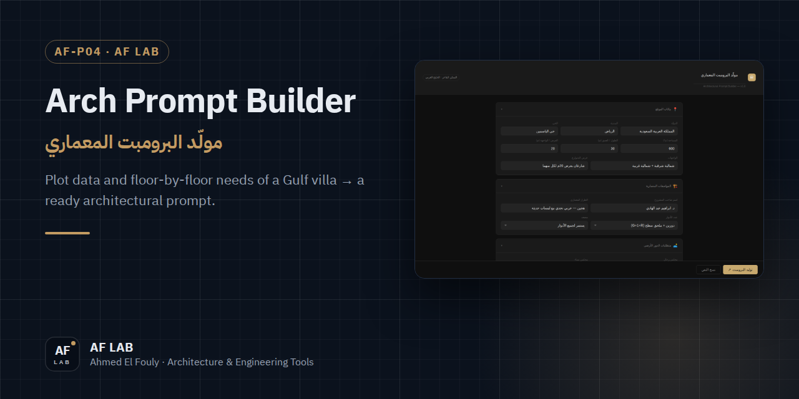
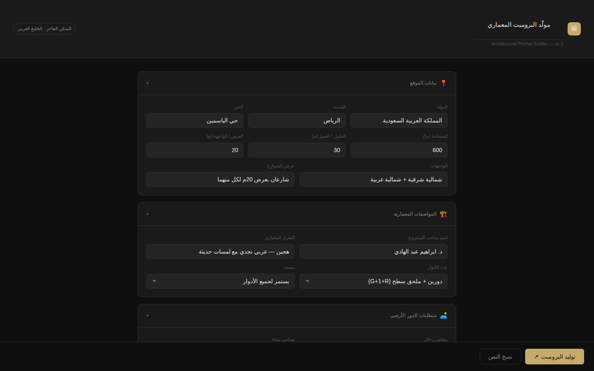

<p align="center">
  
</p>

<h1 align="center">Arch Prompt Builder</h1>

<p align="center">
  <b>اكتب بيانات الأرض ومتطلبات كل دور لفيلا خليجية، واحصل على برومبت معماري جاهز</b><br>
  Enter plot data and floor-by-floor requirements of a Gulf villa and get a ready architectural prompt.
</p>

<p align="center">
  <a href="https://af-lab.archprompt.workers.dev"></a>
  <a href="https://engfouly1987.github.io/arch-prompt-builder/"></a>
  
  
</p>

<p align="center">
  <a href="https://engfouly1987.github.io/arch-prompt-builder/"><b>فتح الأداة · Open the tool ↗</b></a> &nbsp;·&nbsp;
  <a href="https://af-lab.archprompt.workers.dev">AF LAB</a> &nbsp;·&nbsp;
  <a href="https://wa.me/201284537045">WhatsApp</a>
</p>

---

## نظرة سريعة · Overview

<div dir="rtl">

**مولّد البرومبت المعماري** نموذج بيانات مرتّب لفيلا في الخليج العربي: بتملا بيانات الموقع والمواصفات ومتطلبات كل دور، وهو يبني لك برومبت معماري كامل جاهز للنسخ.

</div>

A structured form for a Gulf-style villa brief. Fill in the site, the specifications and each floor's requirements, and it assembles one complete architectural prompt, ready to copy.

<p align="center">
  
</p>

## إيه اللي بتدخله · What you enter

| القسم · Section | الحقول · Fields |
|---|---|
| 📍 بيانات الموقع · Site | الدولة، المدينة، الحي، المساحة، الطول والعرض، الواجهات، عرض الشوارع · country, city, district, area, plot depth and width, facades, street widths |
| 🏗️ المواصفات · Specs | اسم صاحب المشروع، الطراز المعماري، عدد الأدوار، المصعد · owner, architectural style, floors, elevator |
| 🛋️ الدور الأرضي · Ground floor | مجلس رجال ونساء، غرف الخدمة، الكراج، مكتب ومكتبة · men's and women's majlis, service rooms, garage, office and library |
| 🛏️ الأدوار العلوية · Upper floors | عدد غرف النوم، أجنحة الماستر، غرف الحمامات المشتركة، غرفة ألعاب الأطفال، الصالة العائلية · bedrooms, master suites, shared-bath rooms, kids' room, family lounge |
| 📝 إضافات · Extras | أي اشتراطات خاصة · any special requirements |

## الاستخدام · How to use

<div dir="rtl">

1. املا بيانات الموقع والمواصفات.
2. حدّد متطلبات كل دور.
3. اضغط **توليد البرومبت**.
4. اضغط **نسخ النص** والصقه في أداة الذكاء الاصطناعي.

</div>

## تشغيل محلي · Run locally

```bash
git clone https://github.com/engfouly1987/arch-prompt-builder.git
cd arch-prompt-builder
# افتح index.html في المتصفح · open index.html in your browser
```

مفيش تثبيت ولا خادم. ملف واحد يشتغل مباشرة. · No install, no server: it runs straight from the file.

## المساهمة · Contributing

<div dir="rtl">

أي اقتراح أو تحسين مرحّب بيه: افتح Issue أو اعمل Fork و Pull Request.

</div>

## الترخيص · License

MIT

## التواصل · Contact

<div dir="rtl">

للاستفسار أو طلب أداة أو تعديل، أسرع طريقة **واتساب**. وباقي القنوات تحت.

</div>

| | |
|---|---|
| 💬 WhatsApp | [+20 128 453 7045](https://wa.me/201284537045) |
| ✉️ Email | [ahmedfouly08@gmail.com](mailto:ahmedfouly08@gmail.com) |
| 🌐 AF LAB | [af-lab.archprompt.workers.dev](https://af-lab.archprompt.workers.dev) |
| Facebook | [ahmed.fooly](https://www.facebook.com/ahmed.fooly) |
| Instagram | [@ah.elfouly](https://www.instagram.com/ah.elfouly/) |
| GitHub | [engfouly1987](https://github.com/engfouly1987) |

---

<p align="center">
  <sub>جزء من <a href="https://af-lab.archprompt.workers.dev"><b>AF LAB</b></a> — أدوات ومؤلفات وتطبيقات ويب للمهندسين والمعماريين.<br>
  Part of <a href="https://af-lab.archprompt.workers.dev"><b>AF LAB</b></a> — tools, books and web apps for engineers and architects.</sub>
</p>
